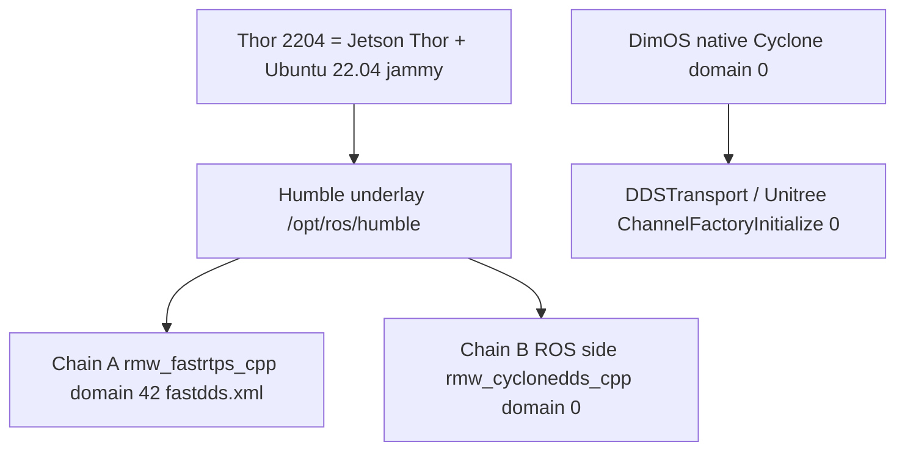
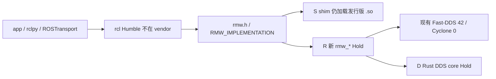

# Thor 2204 Rust DDS plan（文档计划 — 不是实现）

Status: **计划 — 本切只写文档，不实现、不重测、不发明分位数、不声称已达 ×100。**

目标主机类：**NVIDIA Jetson Thor + Ubuntu 22.04（jammy）**，下文称 **Thor 2204**。本仓要把现有 ROS 2 DDS / RMW 路径在该主机类上做一次 **Rust 现代化计划**，但必须先诚实对齐本仓已经落地的双链契约与 SCOREBOARD 配方。

两条**硬要求**（本页只定义怎么证明，不预填结果）：

1. **行为对等（parity）**：与本仓现用 ROS 2 DDS 路径的公开 RMW 契约 / QoS / topic 语义一致；禁止静默改行为。
2. **性能拉伸目标（stretch）**：相对**当前 SCOREBOARD 基线路径**追求约 **×100**。这是 **stretch DoD，必须实测，不得宣称**。可能达不到；达不到时按 §8 的 go / no-go 停，而不是改数字或改配方。

**本 PR 是 one-layer：planning only。** 不编 vendor、不改 [`config/fastdds.xml`](../../config/fastdds.xml)、不改 [`docs/artifacts/bench/SCOREBOARD.md`](../artifacts/bench/SCOREBOARD.md)、不改 `dimos_bridge` DDS 行为。Agnocast / zenoh / Cega / 跨机仍 Hold，除非 owner 另批解禁。

**不是** 飞书现场 / 实机 / 跨机根因证明。Not Feishu field proof. 无假分位数。

---

## 0. 硬规则

1. **文档先于代码。** 本页合入后，任何 Rust / RMW / DDS 实现必须另开 PR，且一次只动一层（见 [feishu-risk-matrix.md](feishu-risk-matrix.md) §9.4）。
2. **对等先于加速。** 没过 §6 对等矩阵，不得谈 ×100，也不得把「编译过 / 跑通过」写成行为不变。
3. **不发明数字。** 不把 SCOREBOARD 表内 p50 / p95 / p99 抄进本文当新基线。方法怎么分段只认 [latency-attribution.md](latency-attribution.md)。数字只在 SCOREBOARD **pointer** 与日后**新日期目录**里记账。
4. **不重写 XML / 不改 SCOREBOARD。** [`config/fastdds.xml`](../../config/fastdds.xml) 仍是 iter7 只读契约种子。SCOREBOARD 仍是 current-best **pointer only**。same-topology XML tuning is paused。
5. **不接 Agnocast / zenoh / Cega。** 不 vendor `rmw_zenoh`，不装 kmod，不改 `dimos_bridge` 运行时，不重写 Bridge。[feishu-cega-bridge-hold.md](feishu-cega-bridge-hold.md)。
6. **自定义 RMW / DDS core fork 默认仍 Hold。** 本页把它们写成**选项**，落地须 owner 解 Hold / `allow-hold-bypass`。本切不把计划写成「已经可以自研 RMW」。
7. **跨机 UDP 仍 `STATUS: blocked`**（无第二台物理机时禁止填假分位数）。见 [`2026-09-11-cross-host/`](../artifacts/bench/2026-09-11-cross-host/README.md)。
8. **《3》–《6》仍 Hold。** bench 分数闭环 / Mac HIL / Promptfoo / CVE 不在本计划实现范围。
9. **Rolling ≠ Humble。** vendor 是对照快照，不是 `/opt/ros/humble` 已加载 `.so`。[feishu-runtime-provenance.md](feishu-runtime-provenance.md)。`prove_rmw.py` 是 env / 字符串身份闸，不是 modified `.so` 证明。
10. **产品 DoD 今天仍 unmet / blocked。** [feishu-dod-evidence.md](feishu-dod-evidence.md)。本计划不假装五项产品验收已过。
11. **编排另页（只此一份，不另开工厂 markdown）。** 千任务池 / steward+N / 自动对等见 [thor-2204-task-pool-factory.md](thor-2204-task-pool-factory.md)。DDS/RMW 须先冻结契约 + 录 stock ROS 2 DDS golden，再切带 `deps` 的 DAG（不是 1000 个无依赖文件）。一台 Linux cloud VM 的 proven N = **1 steward + 2–4 workers**（100 = 未来规模）。Auto-accept = 同一 fixture 上相对 stock 的行为合同，**不是**编译过或假哈希。Box 上 `prove_rmw`/`print-a` 两侧 `ROS not loaded` 且 `cmp` 相同 = **baseline-vs-baseline only**，`shim/` 仍 ABSENT，不得称 Thor/shim 对等。真实对等还缺：Humble（或等价 `.so`）、计划路径下的第一批 `shim/` 产物、steward **入仓**并可 `git pull` 复跑（仓外 `thor-steward-proto` 只是 box-only）。本页不实现工厂。完整 ROS 2 重写不在第一刀。**禁止无人类 合 merge `main`。**

---

## 1. Thor 2204 是什么（范围）

| 项 | 本计划的定义 | 本仓今天的事实 |
|----|--------------|----------------|
| **Thor** | NVIDIA Jetson Thor 一类 aarch64 板端（含 JetPack / L4T 用户态）。本页不绑定未入库的板级 BOM / 未测量的 GPU 零拷路径 | 本仓**没有** Thor 板级树、没有 Thor 专用 Dockerfile、没有 Thor 上的已记账 bench |
| **2204** | Ubuntu **22.04 jammy**。Humble 官方支持面是 jammy，不是 noble | [`docker/ros/`](../../docker/ros/NOTES.md) 配方是 Humble（`ROS_DISTRO=humble`），不钉 RMW / 域。已记账 Chain A 产物的容器 OS 是 **x86_64 Ubuntu 22.04.5 LTS / Humble**，**不是** Thor |
| **Rust 现代化** | 用 Rust 重写或包一层 ROS 2 DDS / RMW 路径的**候选**，必须先过对等再谈加速 | 本仓**没有**自定义 RMW，没有 Rust RMW / Rust DDS 树。公开栈在 `vendor/`（C++），运行时默认仍是发行版 Humble `.so` |
| **不在范围** | LCM / Darwin SHM、Agnocast、zenoh、eCAL、DPDK、Vendor Isaac / NITROS 当跨机替代、Cega、改 `dimos_bridge` DDS、改 XML / SCOREBOARD | 见 [AGENTS.md](../../AGENTS.md) Hold；NITROS 只能帮同进程 CPU↔加速器，**不能**代替域 42/0 或跨机 UDP（[nitros-vs-dual-chain.md](nitros-vs-dual-chain.md)） |



**禁止：** 把已记账 x86_64 容器分位数当成 Thor 已测基线。  
**禁止：** 把 Jazzy / Ubuntu 24.04 代理结果写成 Humble / 2204 已认证（见 [2026-09-mac-hil-native.md](../testing/2026-09-mac-hil-native.md)：noble 上的 Jazzy ≠ jammy Humble）。  
**禁止：** 把「板上有 GPU / NITROS」写成 DDS 已加速。

Thor 2204 上的**第一件测量工作**不是写 Rust，而是用现有配方在该主机类上复现 SCOREBOARD 指针路径，得到 **Thor-host baseline**（新日期目录）。没有这块，×100 没有分母。

---

## 2. 当前双链基线指针（本切不重测）

本仓已经是**两条独立栈**，不共享域 / RMW / QoS，除非操作员显式对齐。混用默认值是 **discovery 失败**，不是单栈时延。权威指针：[feishu-dual-chain-baseline.md](feishu-dual-chain-baseline.md)（SCOREBOARD **pointer only**；**no XML rewrite**；**same-topology XML tuning is paused**）。

| 链 | 角色 | 契约 | 本仓落点 |
|----|------|------|----------|
| **A — nav FastDDS** | 导航 / Foxglove / ROS 2 RMW | `rmw_fastrtps_cpp`，`ROS_DOMAIN_ID=42`，[`config/fastdds.xml`](../../config/fastdds.xml) | [`config/env/chain_a.sh`](../../config/env/chain_a.sh)；vendor 对照 `vendor/rmw_fastrtps` + `vendor/Fast-DDS` |
| **B — DimOS Cyclone** | DimOS 原生 DDS / Unitree | Cyclone **域 0**；ROS 侧名 `rmw_cyclonedds_cpp`；默认 **`unset CYCLONEDDS_URI`** | [`config/env/chain_b.sh`](../../config/env/chain_b.sh)；vendor 对照 `vendor/rmw_cyclonedds` + `vendor/CycloneDDS` **11.0.1** |

R0 冻结表（域 / topic / 导航 QoS）：[ros2-dds-r0-interface-freeze.md](ros2-dds-r0-interface-freeze.md)。  
库默认 QoS（`DimosROS` / `RawROS`：`RELIABLE` / `KEEP_LAST` / `VOLATILE` / `depth=5000`）**不是**冻结表导航 QoS。评测必须写清测的是哪一张表。

**SCOREBOARD = current-best pointer only。** [`docs/artifacts/bench/SCOREBOARD.md`](../artifacts/bench/SCOREBOARD.md) 页眉写：Path B、docs only、无新旋钮、XML 仍是 **iter7 seed**、不重测、不改中间件行为。leftover 旋钮家族（SIMPLE lease / WLP / `port_queue_capacity` / exclusive SHM 等）= **Forbidden to retry**。本文**不打开、不抄**表内分位数。

可复现入口（本计划的测量真源，不是新旋钮）：

- 配方：[scripts/bench/README.md](../../scripts/bench/README.md)、[docs/usage/benchmark-dds.md](../usage/benchmark-dds.md)
- 日期索引：[docs/artifacts/bench/README.md](../artifacts/bench/README.md)
- 分段方法（禁止 Σ P99）：[latency-attribution.md](latency-attribution.md)
- 身份闸：[`scripts/prove_rmw.py`](../../scripts/prove_rmw.py)（env / 字符串，不是 modified `.so`）

`import` [`config/env/load.py`](../../config/env/load.py) **不**写 `os.environ`。操作员必须显式 `source` / apply。

---

## 3. 两条硬要求怎么读

### 3.1 行为对等（硬门，先于一切加速）

对等的对象是**本仓现用路径的公开契约**，不是「感觉差不多」：

| 面 | 必须保持 | 权威 |
|----|----------|------|
| 双链隔离 | 链 A 域 42 + `rmw_fastrtps_cpp` + 只读 XML；链 B 域 0 + Cyclone / `rmw_cyclonedds_cpp` + 不设 URI。禁止默默并域 | R0 · dual-chain baseline |
| 公开 RMW ABI | `rmw.h` 的 publish / take / wait / QoS / gid / 图 / 服务语义；`RMW_IMPLEMENTATION` 可切换；`publish()` 返回 ≠ 对端已送达 | [ros2-source-map.md](ros2-source-map.md) · [feishu-executor-waitset.md](feishu-executor-waitset.md) |
| Topic 名字 | R0 冻结子集（`/cmd_vel`、`/goal_pose`、`/way_point`、`/joy`、Go2 四条绑定） | R0 §2 |
| QoS | 导航冻结表 vs `testdata.py` bench 名 vs 库默认 **三套分开写**；Rust 路径不得把其中一套偷偷换成另一套 | R0 · bench README |
| 发现 / 域 | 42 与 0 仍互不可见，除非操作员显式对齐 | R0 §1 陷阱 |
| Unitree | bundled Cyclone **0.10.2** ≠ vendor **11.0.1** drop-in（**drop-in FAIL / wire UNPROVEN**）。默认 bundled | [unitree-sdk2-dds-swap.md](unitree-sdk2-dds-swap.md) |
| 应用面 | 应用继续写 `rclpy` / `ROSTransport` / `DDSTransport`。不在应用层再抽「第三条链」 | [feishu-sink-layers.md](feishu-sink-layers.md) |

对等**失败** = no-go，即使同一台 Thor 上 RTT 变好。

### 3.2 ×100 是 stretch DoD，不是已声称事实

| 说法 | 本页立场 |
|------|----------|
| 「Rust 重写会快 100 倍」 | **禁止。** 未测不得写 |
| 「相对 SCOREBOARD 现有路径，Thor 2204 上追求 ×100」 | **允许写成 stretch 目标**，分母必须是 **同链 × 同拓扑 × 同尺寸 × 同配方** 的实测（先 Thor-host 复现，再 Thor-host + 候选层） |
| 「用 x86 容器旧表去除以一个 Thor 新数」 | **禁止。** 主机类变了，不是 like-to-like |
| 「只报 p50 / 均值」 | **禁止。** 必须 p50 / p95 / p99 **加上** jitter（高频小包还要到达间隔 \|I−gap\|） |
| 「达不到 ×100 就算项目失败、应改 SCOREBOARD」 | **禁止。** 达不到就记实测比、走 §8 no-go 或降级目标；SCOREBOARD 数字不改 |

若已记账 same-host / same-process RTT 已经在亚毫秒量级（数字只在 SCOREBOARD，本文不抄），再 ×100 会进入计时器分辨率、调度噪声和单次系统调用成本的同一量级。**stretch 可以诚实失败。** 这不是授权去拧 XML 或换 zenoh。

---

## 4. Rust 层选择（选项，不是本切已决实现）

飞书 §9.4 层序：env/XML → RMW → DDS knobs → Executor/memory → **core fork 最后**。本仓甚至没有 vendor `rcl` / `rclcpp`。自定义 RMW 与 DDS core 今天都是 **Hold**（[feishu-sink-layers.md](feishu-sink-layers.md)）。下表只比较**若 owner 解 Hold** 该从哪一层进，便于后续一刀一层。

| 选项 | 落点 | 对等前景 | 加速前景（未测） | Hold / 代价 |
|------|------|----------|------------------|-------------|
| **S — Shim（推荐先做）** | Rust 进程内或 `cdylib` 薄层：仍 `dlopen` 现有 Humble `rmw_fastrtps_cpp` / `rmw_cyclonedds_cpp`，或只包 bench / 身份探测 | **最高。** 不换 DDS、不换域、不换 XML | **最低。** 多一层调用，×100 几乎不可能；用途是把测量与 FFI 边界钉住 | 不自动解「自定义 RMW」Hold。禁止在 shim 里改 QoS / topic |
| **R — 新 `rmw_*`（Rust 实现公开 RMW ABI）** | 新包名（例如计划名 `rmw_hzj_rs`，**本仓尚未存在**）经 `RMW_IMPLEMENTATION` 装载；对上 `rmw.h`，对下仍接现有 Fast-DDS **或** 另选 DDS | **中。** 必须逐条对等 `rmw.h` + 本仓 QoS 名；装错 `.so` 就是静默行为变化 | **未知。** 只有对等过后再测。加速只可能来自少拷贝 / 少分配 / 更短 take 路径，不是语言本身 | **自定义 RMW = Hold**，须 owner 解禁。禁止覆盖发行版 `rmw_fastrtps_cpp` 文件名。须 `prove_rmw.py` 能打印**新** identifier，且旧链仍可切回 |
| **D — DDS core（Rust 重写 Fast-DDS / Cyclone 核心）** | 替换 Writer/Reader History、发现、传输 | **低。** 线缆 / 发现 / History 语义极易漂；Unitree 已有 0.10.2 vs 11.0.1 **drop-in FAIL** 先例 | **未知，且最容易假装。** 没有对等就没有合法加速 | **core fork 最后 + Hold。** 不改 XML 去迁就新核。不接 zenoh / Agnocast 当「更快的核」 |



**本计划的默认顺序（在解 Hold 之前也适用）：S 钉测量 → 若 owner 批则 R 对等 → D 默认 no-go。**  
不要从 D 起手。不要把 S 的 FFI 开销写成「已经 Rust 化完成」。

---

## 5. 分阶段（实现不在本 PR）

| 阶段 | 做什么 | 不做什么 | 退出条件 |
|------|--------|----------|----------|
| **P0 — 本 PR** | 本页 + [thor-2204-task-pool-factory.md](thor-2204-task-pool-factory.md)（含 golden/harness 合同、`deps`、box evidence）+ README / AGENTS 指针 | 任何 `.rs` / vendor / XML / SCOREBOARD / `dimos_bridge` DDS / 第二份工厂页 / 真 worker | 文档合入；13 gate 仍绿；box `cmp` 只记 baseline-vs-baseline；**人类 合 之前不 merge `main`** |
| **P0.5 — 冻结 + golden，再切 DAG** | 钉 R0 / 13-gate；录 stock ROS 2 DDS golden；票带 `deps`。解除对等还要：Humble（或等价）、`shim/` 首批产物、in-repo steward | 不假装 1000 文件无依赖；不把 `ROS not loaded`×2 当 shim PASS；不把仓外 proto 当 CI | 夹具合同写清；缺件 **UNVERIFIED** / `blocked` |
| **P1 — Thor-host 复现** | 在 Thor 2204（jammy + Humble）上跑现有 `run_chain_a.sh` / `docker_chain_a.sh` / `run_imu_hf.sh` / `run_large_packet.sh`；写**新日期目录** `summary.md` + `raw.json` + `environment.md`（须含 SoC / L4T / `uname -m` / Humble 包版本 / git SHA） | 不改 XML；不抄旧 x86 表当本机 delta；不跑《3》打分闭环 | 至少 Chain A `same-process` + `same-host` 复现完成或诚实 `STATUS: blocked`（缺板 / 缺 Humble） |
| **P2 — 层选择闸** | owner 书面选 S / R / D；若选 R 或 D，走 `allow-hold-bypass` | 代理选 zenoh / Agnocast / Cega | 书面选择 + Hold 状态更新（另 PR） |
| **P3 — 对等矩阵** | 按 §6 在 Thor 上跑功能对等（先 S 或 R；D 另议） | 一边对等一边改 QoS「为了更快」 | §6 必测项全过，或逐条 blocked 并写缺件 |
| **P4 — 性能环** | 按 §7 对 **P1 分母** 做 like-to-like；p50/p95/p99 + jitter；按 [latency-attribution.md](latency-attribution.md) 分段归因 | 不 Σ P99；不把 A/B 合成一张表；不改 SCOREBOARD 旧行 | 写出实测比。×100 过或不过都记账 |
| **P5 — 产品闸** | 只有 P3+P4 都过，才谈回滚证明与产品阈（[feishu-dod-evidence.md](feishu-dod-evidence.md) 五项） | 文档闸绿 ≠ 产品 DoD | 五项仍可能 unmet；禁止写 PROVEN 除非 modified `.so` 真加载 |

缺 Thor 板、缺 jammy Humble aarch64、缺第二台跨机主机时：**停在 P1 的 `STATUS: blocked`**，不要用 qemu-amd64 或 noble/Jazzy 代理冒充 2204。

---

## 6. 对等测试矩阵

每条只标一个拓扑：`same-process` / `same-host` / `cross-host-UDP`。链 A 与链 B **分表**。缺件写 `STATUS: blocked`，禁止填假 PASS。

### 6.1 身份与装载（无假 `.so`）

| ID | 断言 | 怎么跑 | 通过 | 失败 |
|----|------|--------|------|------|
| I1 | 操作员 `source chain_a.sh` 后身份仍是 `rmw_fastrtps_cpp` / 域 42 / XML 指向现有种子 | `python3 config/env/load.py print-a` · `python3 scripts/prove_rmw.py` | 打印契约；有 Humble 时 identifier 与请求一致 | 默默换成新 RMW 名或域 0 |
| I2 | `source chain_b.sh` 仍是 `rmw_cyclonedds_cpp` / 域 0 / `CYCLONEDDS_URI` unset | `print-b` · `prove_rmw.py` | 同上 | 带上链 A XML 或设了 Cyclone URI |
| I3 | `import load.py` 不写 `os.environ` | 已有 env 交叉闸 | 不变 | import 污染 |
| I4 | 若选选项 R：新 identifier **可切回**旧实现 | 显式 `RMW_IMPLEMENTATION` 来回切 | 两套都能 `prove_rmw` | 覆盖发行版文件名 / 不可回滚 |
| I5 | vendor SHA ≠ 已加载 `.so` | [feishu-runtime-provenance.md](feishu-runtime-provenance.md) | 分层仍写 underlay ≠ snapshot | 把 rolling vendor 铺进 Humble |

### 6.2 发现与 topic 语义

| ID | 断言 | 备注 |
|----|------|------|
| D1 | 域 42 与域 0 默认互不发现 | 混默认 = discovery 失败，不是时延 bug |
| D2 | R0 冻结 topic 名字不变；未列入冻结表的 topic **不**享受行为不变承诺 | [ros2-dds-r0-interface-freeze.md](ros2-dds-r0-interface-freeze.md) §2 |
| D3 | `/foxglove_teleop`→`/cmd_vel` 仍是 Twist→TwistStamped，QoS `BEST_EFFORT` / `KEEP_LAST` / `depth=1` | 导航契约，不是库默认 depth=5000 |
| D4 | `/goal_pose`、`/way_point` 仍 `RELIABLE` / `VOLATILE` / `KEEP_LAST` / `depth=5` | 同上 |
| D5 | 三条链地图仍是 map ≠ reproduce，直到 Thor 上真的跑完 publish / History / wait→callback | [feishu-three-chain-repro.md](feishu-three-chain-repro.md) 今天 `STATUS: blocked` |

### 6.3 QoS / History / 可靠性

| ID | 断言 |
|----|------|
| Q1 | bench 用 `testdata.py` 的 `high_throughput` / `reliable` **名**时，Rust 路径不得改写成导航冻结 QoS |
| Q2 | `KEEP_LAST` depth 与 reliability 在对端可见（丢失 vs 重传行为与基线同一配方一致） |
| Q3 | `publish()` / `rmw_publish()` 返回 `RMW_RET_OK` 仍 **≠** 对端已入 History / 已 callback |
| Q4 | WaitSet → `rmw_wait` → take → callback 身份仍在；不 fork Humble executor | [feishu-executor-waitset.md](feishu-executor-waitset.md) |
| Q5 | 链 B 原生路径仍走 `on_data_available` / `reader.take()`，不假装成 `rclpy` executor |

### 6.4 互操作

| ID | 断言 | 现状 |
|----|------|------|
| X1 | Rust 候选（若走 R）必须能与**未改**的发行版 Fast-DDS 对端在域 42 互通，或诚实写 UNPROVEN | 未测 |
| X2 | 不得把 vendor Cyclone 11.0.1 写成 Unitree 0.10.2 的 drop-in | **drop-in FAIL / wire UNPROVEN**（已裁决，本页不重判） |
| X3 | `cross-host-UDP` 无第二台 = `STATUS: blocked` | 已记账 blocked |

P3 最低集：I1–I3、D1–D2、Q1–Q3。I4 仅选项 R。D3–D4 要有导航消息类型与 Humble。X1 要有未改对端。缺件 blocked，不编 PASS。

---

## 7. 性能测量环（从现有 SCOREBOARD / bench 配方出发）

### 7.1 配方，不新造旋钮

沿用已有入口，**不要**为本 stretch 新发明 XML 家族（leftover = Forbidden to retry）：

| 用例 | 已有配方 | 拓扑（一次一个） | 指标 |
|------|----------|------------------|------|
| 默认尺寸 ping-pong | `run_chain_a.sh` / `docker_chain_a.sh`；链 B `run_chain_b.sh` | `same-process`、`same-host` | RTT p50 / p95 / p99（[`scripts/bench/pingpong.py`](../../scripts/bench/pingpong.py)） |
| 大包（100 KiB / 256 KiB / 1 MiB，gap 100 ms） | `run_large_packet.sh` | 同上；跨机 blocked | 同上；1 MiB 走现有 builtin 分片路径（XML 不改） |
| IMU 尺度（64 B / gap 5 ms / 目标 200 Hz） | `run_imu_hf.sh` | 同上 | RTT p95/p99 **加** 到达间隔 jitter `\|I−5 ms\|`；**禁止**只报 p50/均值 |
| 跨机 UDP | `run_cross_host_a.sh` | 仅 `cross-host-UDP` | 无第二台则 blocked |

上游 `pytest -m tool -k dds` 的 Latency 列是 drain time，**不是** per-message 分位。分位数只认 `pingpong.py`。

一次 run 必须落：`summary.md` + `raw.json` + `environment.md`。挂到新的 `docs/artifacts/bench/<UTC-date>/`，并在 [docs/artifacts/bench/README.md](../artifacts/bench/README.md) 做日期索引。**不要**改 SCOREBOARD 旧行；若将来要把 Thor 复现标成 current-best，那是**另一次**人类合并的记分板 PR，不在本计划实现。

### 7.2 分母 / 分子（like-to-like）

```
stretch_ratio(metric) = baseline_thor(metric) / candidate_thor(metric)
```

- **分母 `baseline_thor`：** P1 在 Thor 2204 上、**现有 Humble RMW + 只读 XML**，同链同拓扑同尺寸同 `BENCH_*`。
- **分子 `candidate_thor`：** 同一块板、同一配方、只换成 §4 所选层（S/R/D）。
- **禁止**用 x86 SCOREBOARD 旧表当分子或分母。
- **禁止**链 A 与链 B 相除。
- **禁止** `same-process` 与 `same-host` 与 `cross-host-UDP` 混除。
- **禁止** `P99(T_e2e) := Σ P99(段)`。

×100 stretch 的判定（**测后**才填）：对**预先书面点名**的少数格子（建议先点名 Chain A IMU `same-host` 的 RTT p95 与 `\|I−5 ms\|` p95，以及默认 64 B `same-host` RTT p99）是否 `stretch_ratio ≥ 100`。没点名的格子即使碰巧很大也不许合成「总 ×100」。点名格子达不到 = stretch unmet，**不是**授权改 XML。

### 7.3 归因（没有数字也要把方法钉死）

分段仍是：

```
T_e2e = T_app_pub + T_rmw_pub + T_dds_write + T_transport + T_dds_ingress + T_rmw_take + T_callback
```

本仓 CI **不**给各段打时间戳。P4 若要归因，必须在**同一组端到端样本**上加分段探针，或诚实写「本 run 只有闭环 RTT，未分段」。禁止用语言（Rust vs C++）当根因。vendor SHA **不能**当根因。先 `prove_rmw.py`（加载了谁），再谈是哪一段动了。

---

## 8. 风险 / Hold 清单与 go/no-go

### 8.1 仍 Hold（除非 owner 书面解禁）

| 项 | 状态 | 本计划 |
|----|------|--------|
| [`config/fastdds.xml`](../../config/fastdds.xml) | 只读 iter7 | 不改 |
| [`docs/artifacts/bench/SCOREBOARD.md`](../artifacts/bench/SCOREBOARD.md) | pointer only，数字冻结 | 不改、不抄表内分位 |
| same-topology XML 再拧 | paused；leftover **Forbidden to retry** | 不发明新旋钮家族 |
| Agnocast / zenoh / `rmw_zenoh` / kmod | Hold | 不当成 Rust 加速捷径 |
| Cega / `dimos_bridge` DDS 运行时 | Hold（[feishu-cega-bridge-hold.md](feishu-cega-bridge-hold.md)） | 不接、不改 |
| 自定义 RMW（选项 R） | Hold | 无 bypass 则停在 S |
| DDS / `rcl` core fork（选项 D） | Hold；§9.4 最后 | 默认 no-go |
| 跨机 UDP | `STATUS: blocked`（单机） | 无第二台不填数 |
| 《3》–《6》 | Hold | 不把本计划当分数闭环 |
| Unitree 0.10.2 vs 11.0.1 | drop-in FAIL / wire UNPROVEN | 不重判 |
| 三条链 reproduce | map ≠ reproduce；本自动化主机 blocked | 不编 PASS |
| Loaned / Data Sharing / Iceoryx 运行时 | Hold | AUTO ≠ 已开零拷 |
| Vendor Isaac / 用 NITROS 代替双链 | Hold | 见 nitros 专页 |

### 8.2 现实路径（很可能达不到 ×100）

诚实顺序：

1. P1 复现。没有 Thor-host 分母 → **停**，stretch 未定义。
2. 默认做 **S**，把 FFI / 配方 / 身份钉死。此时加速比预期 ≈ 1× 或更差。
3. 若 owner 解 Hold，做 **R** 且 **P3 全过**，再跑 P4。
4. 把实测 `stretch_ratio` 记进**新**日期目录。预期多数格子在 1× 附近；个别同进程少拷贝路径可能更高，**仍不是**宣称 ×100 的许可。
5. **D** 只在 R 对等已过、且 owner 接受线缆 UNPROVEN 风险时单开。本计划不承诺这一刀。

### 8.3 Go / no-go

| 闸 | Go | No-go（停或另开人类决策，不改旧 SCOREBOARD） |
|----|----|-----------------------------------------------|
| G0 本 PR | 只含文档 / 指针 / 日志 | 出现 vendor、XML、SCOREBOARD、`dimos_bridge` DDS、Rust 实现 |
| G1 主机类 | Thor + jammy + Humble aarch64 已证明（`environment.md`） | 用 x86 容器、qemu-amd64、noble/Jazzy 冒充 2204 |
| G2 对等 | §6 最低集通过 | 任一对等失败却继续报加速 |
| G3 配方 | 同链同拓扑同尺寸；有 p50/p95/p99；IMU 有 jitter | 只报均值；混表；改 XML 换分母 |
| G4 stretch | 点名格子 `stretch_ratio ≥ 100` **且** G2/G3 仍绿 | 达不到 → 记 unmet，保留现有路径；**不**为凑倍数换 zenoh / 改 XML |
| G5 回归 | p99 或 IMU jitter 相对 `baseline_thor` 变差 | 变差 = 丢弃候选，与 iter8/iter9 丢弃旋钮同一纪律 |
| G6 产品 | 五项 DoD 另证 | 文档闸绿 ≠ `DoD: unmet` 已解除 |
| G7 Hold | owner 书面 bypass | 无 bypass 进入 R/D/Cega/Agnocast |

**G4 no-go 是预期可能。** 本计划成功标准是「对等可证 + 加速可测 + 失败可停」，不是「必须 ×100」。

---

## 9. 本 PR 是什么 / 不是什么

| 是 | 不是 |
|----|------|
| 计划文档 + [千任务池编排](thor-2204-task-pool-factory.md)（一份） | Rust / RMW / DDS 实现；已开工厂；第二份工厂 markdown |
| 指向已有双链基线与 bench 配方 | 新的 SCOREBOARD 行或 XML 旋钮 |
| 对等矩阵 + 测量环 + go/no-go + box baseline-vs-baseline 诚实记录 | 已测 Thor 数、已达 ×100、已加载 modified `.so`、shim 已对等 |
| ITERATION_LOG / 编排扩写 | 《3》–《6》解 Hold |
| 后续实现的分层选项 | 已决「必须自研 RMW」；完整 ROS 2 重写；N=100 已可跑；编译过或假哈希即对等 |

本自动化主机仍无 Humble runtime、无 Thor 板。P1+ 保持 `STATUS: blocked` 直到有主机。禁止在本页或后续评论里写本机 `measured-delta` / `PROVEN`。

---

## 10. 闸门怎么跑（本切只跑已有脚本）

```bash
python3 scripts/run_all_gates.py
```

无 ROS 时应保持现有 13 个 check/prove **exit 0**。本页**不**新增 gate 脚本（one-layer：planning only）。身份 / 基线 / 记分板指针仍认：

```bash
python3 scripts/prove_rmw.py
python3 scripts/check_dual_chain_baseline.py
python3 scripts/print_bench_gates.py
python3 scripts/check_dod_evidence.py
```

成功时这些脚本的既有短语不变（`ROS not loaded`、`dual-chain baseline: pointer only (no XML rewrite)`、`same-topology XML tuning is paused`、`dod evidence: unmet (blocked)`）。

---

## 11. 引用

本仓（已入库，不编造飞书正文）：

1. [feishu-dual-chain-baseline.md](feishu-dual-chain-baseline.md) — §13(3) 双链指针
2. [ros2-dds-r0-interface-freeze.md](ros2-dds-r0-interface-freeze.md) — 域 / topic / QoS 冻结
3. [latency-attribution.md](latency-attribution.md) — 分段；禁止 Σ P99
4. [feishu-sink-layers.md](feishu-sink-layers.md) · [feishu-risk-matrix.md](feishu-risk-matrix.md) — 层序与 Hold
5. [feishu-runtime-provenance.md](feishu-runtime-provenance.md) · [feishu-dod-evidence.md](feishu-dod-evidence.md)
6. [feishu-three-chain-repro.md](feishu-three-chain-repro.md) · [ros2-source-map.md](ros2-source-map.md) · [feishu-executor-waitset.md](feishu-executor-waitset.md)
7. [unitree-sdk2-dds-swap.md](unitree-sdk2-dds-swap.md) · [feishu-cega-bridge-hold.md](feishu-cega-bridge-hold.md)
8. [docs/artifacts/bench/SCOREBOARD.md](../artifacts/bench/SCOREBOARD.md) — current-best **pointer only**
9. [scripts/bench/README.md](../../scripts/bench/README.md) · [docs/usage/benchmark-dds.md](../usage/benchmark-dds.md)
10. [AGENTS.md](../../AGENTS.md) · [ci-cd-gates.md](ci-cd-gates.md)
11. [thor-2204-task-pool-factory.md](thor-2204-task-pool-factory.md) — 千任务池工厂（40 张 shim 票 + `deps` + stock DDS golden 合同 + box DoD；proven N = 1 steward + 2–4 workers）

飞书（查阅指针；本环境仍可能 3380004 无正文）：

12. 《ROS 2 源码闭环》§12 / §13：<https://topsunhzj.feishu.cn/wiki/N0Xaw1vsdiXRD4km9Jvc8kHynBf>
13. 《通信中间件》：<https://topsunhzj.feishu.cn/wiki/XKDbw7blLieO4ykCRgLcUCJKnXe>
