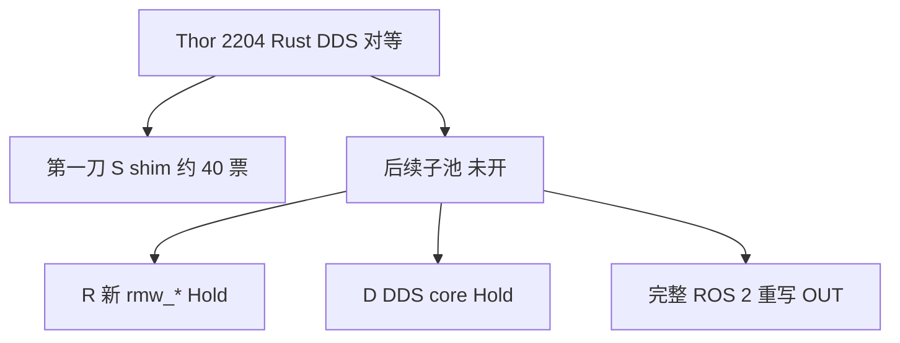
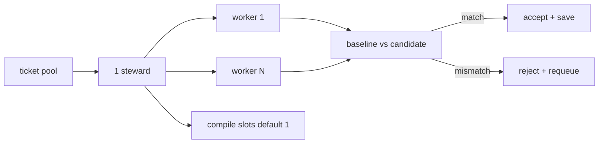

# 千任务池工厂（Thor 2204 编排计划 — 不是已开工厂）

Status: **编排计划 — 本切只写文档。** 没有 steward 进程、没有 worker 池、没有已接受的 ticket、没有 ×100、没有 Thor 已测。禁止把本页写成 `PASS` / `PROVEN` / 已并行编译。

挂在 [thor-2204-rust-dds-plan.md](thor-2204-rust-dds-plan.md)（对等硬门 + ×100 stretch）。本页只回答：**怎么把那份计划拆成互不干扰的小票、一台机器上 1 个 steward + 最多 N 个 worker、用旧 ROS 2 DDS 路径自动验收、人每天看什么进度、Cursor box Linux 怎么空跑。**

**第一刀范围：** 选项 **S（shim）** 对等。仍 `dlopen` 现有 Humble `rmw_fastrtps_cpp` / `rmw_cyclonedds_cpp`。**完整 ROS 2 重写（`rcl` / `rclcpp` / `rclpy` / 消息 / launch / Nav2）不在第一刀，不进本池。** 选项 R / D 仍 Hold，除非 owner 书面解禁后再开子池。

**不是** 飞书现场 / 实机 / 跨机根因。Not Feishu field proof. 无假分位数。

---

## 0. 硬规则

1. **对等先于一切加速。** 每张已完成票必须用**同一组输入**跑 baseline（现有 ROS 2 DDS 路径）与 candidate（本票改动）；**位/行为一致才接受并落盘**；不一致则 **reject + requeue**。编译通过 ≠ 对等。
2. **×100 仍是 stretch DoD。** 只在 Thor-host 复现出 SCOREBOARD 配方分母之后才谈（主计划 §3.2 / §7）。本工厂**不**验收倍数，不发明时延。
3. **不改** [`config/fastdds.xml`](../../config/fastdds.xml)、[`docs/artifacts/bench/SCOREBOARD.md`](../artifacts/bench/SCOREBOARD.md)、`vendor/**`、`dimos_bridge` DDS 运行时。Agnocast / zenoh / Cega / 跨机 UDP 仍 Hold。
4. **一台机器 1 个 steward。** Worker 数 `N` **可配置**。**禁止**声称本仓已跑或将跑「100 路并发编译」。默认编译槽位 = 1，避免 OOM。
5. **无 Humble / 无 Thor 时验收只能做到 env / 字符串 / gate。** `prove_rmw.py` 打印 `ROS not loaded` 并 exit 0 是诚实，**不是** modified `.so` 已加载，**不是** pub/sub PASS。
6. **本 PR 不实现工厂。** 票表是库存；STATUS 文件在 steward 落地后才创建。本页的进度示例是**格式**，不是 live 计数。

---

## 1. 分解模型（百～千是规模，第一刀是 40 张 shim 票）

规模口径：**池的模型是数百到数千张互不干扰的小票**（一个公开 `rmw_*` 符号 × 一条链 × 一种验收配方，再加上 graph / QoS / 服务面）。**现在只开第一刀：shim 层约 40 张**，使人能开工，而不是先填 1000 行空票。



| 层 | 进本池？ | 说明 |
|----|----------|------|
| **S shim** | **是（第一刀）** | Rust/`cdylib` 薄层转发到已加载发行版 `.so`。默认 identifier 仍是 `rmw_fastrtps_cpp` / `rmw_cyclonedds_cpp`，除非票面写明「可切回的新名」且 owner 已解 Hold |
| **R 新 `rmw_*`** | 否，Hold | 主计划 §4 选项 R。无 `allow-hold-bypass` 不建子池 |
| **D Rust DDS core** | 否，Hold | §9.4 最后；默认 no-go |
| **完整 ROS 2 重写** | **OUT** | 不 vendor / 不 fork `rcl`、`rclcpp`、`rclpy`；不重写 `.msg` / `.srv` / `.action`；不写 launch / Nav2。应用继续走现有 API |
| LCM / zenoh / Agnocast / Cega | OUT / Hold | 与主计划 §8.1 相同 |

**互不干扰规则（所有票必须写在票面上）：**

| 字段 | 要求 |
|------|------|
| `id` | 稳定，如 `T-S-013`。不复用 |
| `exclusive_paths` | 本票**唯一**可写路径。两票路径相交 → steward **拒领** |
| `forbidden_paths` | 全局禁止：`config/fastdds.xml`、`docs/artifacts/bench/SCOREBOARD.md`、`vendor/**`、`dimos_bridge/dimos/**`（运行时） |
| `inputs` | 验收用的同一组输入（env、命令、fixture） |
| `accept` | baseline vs candidate 比较器（见 §3） |
| `hold` | `none` / `skip-hold`（票存在但 steward 永不派发） |

后续若要把池扩到「千」：只允许按 **已有 `rmw.h` 符号 × {A,B} × {identity,roundtrip-fixture}** 生成，且每张仍满足上表。禁止为凑数把 XML 旋钮、跨机、Cega 自动灌进池。

---

## 2. 第一刀票表（shim，40 张，可开工）

对照阅读（**不改**这些文件）：[`vendor/rmw/rmw/include/rmw/rmw.h`](../../vendor/rmw/rmw/include/rmw/rmw.h)、[`vendor/rmw_fastrtps/rmw_fastrtps_cpp/src/`](../../vendor/rmw_fastrtps/rmw_fastrtps_cpp/src/)。落地目录是**计划路径**（本 PR 不建树）：`shim/` 下按票 `exclusive_paths` 长出来。

**验收列**只点本仓已有命令。无 Humble 时「blocked」必须原样保留，禁止填 PASS。

### 2.1 工厂骨架（T-S-001 … 007）— 不编译 DDS

| id | 票 | exclusive_paths（计划） | 同一输入 | accept |
|----|----|-------------------------|----------|--------|
| T-S-001 | 票 schema（JSONL 一行一张） | `docs/refactor/task-pool/SCHEMA.md` | 本页 §1 字段清单 | schema 含 `exclusive_paths` / `forbidden_paths` / `accept`；缺一则 reject |
| T-S-002 | STATUS 计数器模板 | `docs/refactor/task-pool/STATUS.md` | §4 计数器名 | 文件含 §4 全部计数器名；数字未跑工厂时为 0 |
| T-S-003 | steward 领取算法（文档+伪代码） | `docs/refactor/task-pool/STEWARD.md` | 相交 `exclusive_paths` 夹具 | 相交票不得同时 `claimed` |
| T-S-004 | 编译槽 / OOM 限流 | 同上 `STEWARD.md` §rate-limit | `THOR_POOL_COMPILE_SLOTS` 默认 1 | 文档写清默认 1；**不**写「100 路并发编译」 |
| T-S-005 | worker 协议（claim → run → report） | `docs/refactor/task-pool/WORKER.md` | 假票 `T-FAKE-1` | 协议含 accept/reject/requeue 三态 |
| T-S-006 | box 空跑夹具 | `docs/refactor/task-pool/fixtures/` | 两份相同 stdout 夹具 | 字节相等 → accept；改一字节 → reject+requeue |
| T-S-007 | Hold 路径黑名单自检 | `scripts/task_pool/`（未来）或夹具 | 试图写 `config/fastdds.xml` 的假票 | steward **拒领**；不得改 XML / SCOREBOARD |

### 2.2 身份 / env（T-S-008 … 012）— 现有脚本即 baseline

| id | 票 | exclusive_paths | 同一输入 | accept |
|----|----|-----------------|----------|--------|
| T-S-008 | `prove_rmw.py` 身份对照 | 仅 shim 探测包装（计划 `shim/identity/`） | 未 source 的干净 env | baseline 与 candidate 的 stdout **去掉易变行**后相等；无 ROS 时两侧都含 `ROS not loaded` |
| T-S-009 | `load.py print-a` | 不得改 [`config/env/load.py`](../../config/env/load.py) 真源 | `python3 config/env/load.py print-a` | 含 `RMW_IMPLEMENTATION=rmw_fastrtps_cpp`、`ROS_DOMAIN_ID=42`、`config/fastdds.xml`；import 前后 `os.environ` 不变 |
| T-S-010 | `load.py print-b` | 同上约束 | `print-b` | `rmw_cyclonedds_cpp` / `ROS_DOMAIN_ID=0`；不 export `CYCLONEDDS_URI=` |
| T-S-011 | `chain_a.sh` 字面契约 | **不改** `config/env/chain_a.sh` | 文件字节 | 与现有 guard 字面串一致；shim 不得改 shell |
| T-S-012 | `chain_b.sh` unset URI | **不改** `chain_b.sh` | 文件字节 | 含 `unset CYCLONEDDS_URI` |

### 2.3 Shim 转发面（T-S-013 … 036）— 一票一符号族，仍加载发行版 `.so`

每张票的 candidate 只**声明 + 转发**下列符号；行为必须与 Humble `rmw_fastrtps_cpp`（链 A）或 `rmw_cyclonedds_cpp`（链 B，若票面写 B）一致。无 Humble = 该票 `STATUS: blocked`，**不是**失败也不是 PASS。

| id | 符号族 | 对照阅读（只读） | accept（有 Humble 时） |
|----|--------|------------------|------------------------|
| T-S-013 | `rmw_get_implementation_identifier` | `rmw_get_implementation_identifier.cpp` | 两侧 identifier 字节相等 |
| T-S-014 | `rmw_get_serialization_format` | `rmw_get_serialization_format.cpp` | 两侧 format 字符串相等 |
| T-S-015 | `rmw_init` / `rmw_shutdown` | `rmw_init.cpp` | 返回码 + 上下文可再 init；域仍由 env 决定 |
| T-S-016 | `rmw_create_node` / `rmw_destroy_node` | `rmw_node.cpp` | 节点名/命名空间往返；destroy 后再 create 不漏 |
| T-S-017 | `rmw_create_publisher` / `rmw_destroy_publisher` | `rmw_publisher.cpp` | 创建失败码一致；成功后 `get_actual_qos` 与 baseline 同 profile |
| T-S-018 | `rmw_publish` | `rmw_publish.cpp` | **同一 payload** 发布后，对端 baseline 订阅者收到的 CDR / 用户数据字节相等（见 §3）。`RMW_RET_OK` ≠ 已送达，两侧都要遵守 |
| T-S-019 | `rmw_create_subscription` / `rmw_destroy_subscription` | `rmw_subscription.cpp` | 同 T-S-017 |
| T-S-020 | `rmw_take` / `rmw_take_with_info` | `rmw_take.cpp` | 同一已入 History 的样本，take 出的数据字节 + `taken` 标志一致 |
| T-S-021 | `rmw_wait` / wait set | `rmw_wait.cpp` / `rmw_wait_set.cpp` | 同一就绪集 / 超时：返回码与「谁就绪」位图一致 |
| T-S-022 | guard condition + trigger | `rmw_guard_condition.cpp` / `rmw_trigger_guard_condition.cpp` | trigger 后 wait 醒来与否一致 |
| T-S-023 | QoS actual + compatible | `rmw_qos.cpp` | `rmw_publisher_get_actual_qos` / `rmw_qos_profile_check_compatible` 结果一致 |
| T-S-024 | `rmw_serialize` / `rmw_deserialize` | `rmw_serialize.cpp` | 同一消息往返字节相等 |
| T-S-025 | GID get + `rmw_compare_gids_equal` | `rmw_get_gid_for_publisher.cpp` / `rmw_compare_gids_equal.cpp` | 同发布者 GID 相等；不同则不等 |
| T-S-026 | logging 转发 | `rmw_logging.cpp` | 仅转发；不改默认日志级 |
| T-S-027 | matched count | `rmw_count.cpp` | 同拓扑下 count 相等（允许 discovery 竞态则重试后仍一致或 blocked） |
| T-S-028 | topic names and types | `rmw_topic_names_and_types.cpp` | 图查询集合相等（排序后） |
| T-S-029 | service names and types | `rmw_service_names_and_types.cpp` | 同上 |
| T-S-030 | client create/destroy | `rmw_client.cpp` | 返回码 / identifier 一致；**不**重写服务语义 |
| T-S-031 | service create/destroy | `rmw_service.cpp` | 同上 |
| T-S-032 | request / response | `rmw_request.cpp` / `rmw_response.cpp` | 同一请求字节往返相等 |
| T-S-033 | events | `rmw_event.cpp` | 事件类型与取事件返回码一致 |
| T-S-034 | features | `rmw_features.cpp` | feature 位一致 |
| T-S-035 | endpoint info | `rmw_get_topic_endpoint_info.cpp` | 排序后记录相等 |
| T-S-036 | loaned message | `rmw_publish.cpp` 贷款路径 | **`hold: skip-hold`**。Loaned / Data Sharing **不落地**（[feishu-sink-layers.md](feishu-sink-layers.md)）。steward 永不派发。票留作库存，避免有人当漏项私自做 |

T-S-013…035 的 `exclusive_paths` 计划为 `shim/fwd/<id>.rs`（或 `.c` FFI）**互不相交**。禁止两张票改同一个转发文件。

### 2.4 配方指针票（T-S-037 … 040）— 不发明数

| id | 票 | 同一输入 | accept |
|----|----|----------|--------|
| T-S-037 | 13 gate 回归 | `python3 scripts/run_all_gates.py` | baseline 绿且 candidate 仍 **13/13**；零-but-missing-marker = reject |
| T-S-038 | 默认 ping-pong 配方指针 | [`scripts/bench/run_chain_a.sh`](../../scripts/bench/run_chain_a.sh) / `docker_chain_a.sh` | 有 Humble 时：同一 `BENCH_*`，candidate 的 `raw.json` **样本序列**与 baseline 按 §3.2 比较。无 Humble / 无 Thor：**`STATUS: blocked`**，禁止填分位 |
| T-S-039 | IMU 64 B / 5 ms 配方指针 | [`scripts/bench/run_imu_hf.sh`](../../scripts/bench/README.md) | 同上；必须含 jitter 字段才谈接受。**不**用 p50 单独 accept。无主机 = blocked |
| T-S-040 | 跨机 UDP | [`scripts/bench/run_cross_host_a.sh`](../../scripts/bench/run_cross_host_a.sh) | **`hold: skip-hold`** + 单机 `STATUS: blocked`。无第二台不派发、不填数 |

**第一刀合计 40 张。** T-S-036 与 T-S-040 是 skip-hold（库存，不算可派发）。可派发约 38 张；其中 T-S-013…035 与 T-S-038/039 在本自动化主机上多数为 blocked（无 Humble），只做身份 / gate / 夹具三张能在 box 空跑（§5）。

---

## 3. 每机模型：1 steward + 最多 N worker

| 角色 | 数量 | 职责 |
|------|------|------|
| **Steward** | **每机恰好 1** | 读池、按 `exclusive_paths` 领取、把票交给空闲 worker、**限流编译/测试**、收集 accept/reject、写 STATUS、requeue |
| **Worker** | `0…N` | 只做领取到的一张票：改 `exclusive_paths`、跑票面 `inputs`、交 baseline 与 candidate 产物。不领第二张、不改 Hold 路径 |

**可配置（计划环境变量，本 PR 不写代码）：**

| 变量 | 默认 | 含义 |
|------|------|------|
| `THOR_POOL_MAX_WORKERS` | `2` | 本机 worker 上限 **N**。box 空跑用 `1` 或 `2` |
| `THOR_POOL_COMPILE_SLOTS` | `1` | 同时进行的 compile/test 槽。默认 1，避免 OOM |
| `THOR_POOL_MEM_RESERVE_MIB` | `1024` | 可用内存低于此值则 steward **暂停发编译票**，只跑纯文档 / 字符串票 |
| `THOR_POOL_CLAIM_TIMEOUT_S` | `7200` | claimed 过期回收 |



**禁止声称：** 「每机 100 worker 并行 colcon」。4-vCPU 共享盒上 N=2、compile slots=1 已经是诚实上限。N 只是旋钮，**不是**已测吞吐。

Steward 领取伪代码（文档，不是实现）：

1. 过滤 `hold != none`、`status in {open, requeued}`。
2. 丢掉与当前 `claimed`/`accepted` 票 `exclusive_paths` 相交的票。
3. 丢掉触及 `forbidden_paths` 的票（T-S-007）。
4. 若票需要编译且槽已满或内存不足 → 留在 open，改派 T-S-001…012 类文档/字符串票。
5. 标记 `claimed` + worker id + 时间。
6. 收回 worker 报告：match → `accepted` 并保存产物；mismatch → `rejected` 且 `requeue_count += 1`（上限 3 次后 `blocked` 等人）。

---

## 4. 自动验收：旧 ROS 2 DDS vs candidate

**比较器优先级（高 → 低）。** 能做字节比较就不要改成「看起来像」。

| 级 | 何时 | 怎么比 | 本仓落点 |
|----|------|--------|----------|
| **A 位** | 两边都写出确定字节（identifier、CDR、env 打印、夹具 stdout） | `cmp` / 哈希；允许票面列出的易变行（时间戳、PID）先剥 | T-S-006、008–014、024 |
| **B 行为** | 返回码、QoS profile、wait 就绪位、`taken` 标志 | 结构化字段全等 | T-S-015–023、027–035 |
| **C 配方** | 有 Humble 且跑了 ping-pong | **先**对等（样本 payload / 丢失计数）。**分位数不参与 accept。** 时延只写入**新**日期目录，不改 SCOREBOARD | T-S-038、039；配方见 [scripts/bench/README.md](../../scripts/bench/README.md) |
| **D 身份闸** | 任何时候 | `prove_rmw.py`、`run_all_gates.py` 必须仍绿 | [scripts/prove_rmw.py](../../scripts/prove_rmw.py)、[scripts/run_all_gates.py](../../scripts/run_all_gates.py) |

**同一输入**（票面写死，worker 不得改）：

- 链：A 必须 `source config/env/chain_a.sh`（或 `load.py` 显式 apply）；B 不得误 source A。
- 域 / RMW / XML：现有契约。candidate **不得**改 XML 来「对上」。
- bench：同一 `BENCH_SIZES` / `BENCH_INTERVAL_MS` / `BENCH_SAMPLES` / topology 标签。
- 无 Humble：只跑 A/B/D 级里不需要 `.so` 的项；C 级写 `STATUS: blocked`。

```
if hash(strip(baseline_out)) == hash(strip(candidate_out)):
    accept; save artifacts under ticket id
else:
    reject; requeue
```

**禁止：** 用「更快」覆盖 mismatch。  
**禁止：** 无第二台时把 T-S-040 标 PASS。  
**禁止：** 把 gate 绿写成产品 DoD 或 ×100。  
**禁止：** Σ P99 或 A-vs-B 一张表当 accept。

×100：工厂**不管**倍数。主计划 P4 在 Thor-host 分母存在之后另开测量票；本池第一刀没有 stretch 票。

---

## 5. 人看的进度条（每天一眼）

Steward 落地后写（本 PR **不**创建 live 文件，避免假进度）：

`docs/refactor/task-pool/STATUS.md` + `docs/refactor/task-pool/pool.jsonl`

Owner 每天只看 STATUS 顶部计数器：

| 计数器 | 含义 |
|--------|------|
| `open` | 未领 |
| `claimed` | 已领未报 |
| `accepted` | 对等通过并已存 |
| `rejected` | 对等失败（将 requeue） |
| `requeued` | 回到池 |
| `blocked` | 缺 Humble / 缺 Thor / 缺第二台 / 超重试。**不是 PASS** |
| `skip_hold` | T-S-036、T-S-040 等，永不派发 |
| `compile_slots_in_use` | 0 或 1（默认） |
| `workers_alive` | ≤ N |
| `last_steward_utc` | steward 心跳 |

格式示例（**合成，不是本机 live**）：

```
# task-pool STATUS — not a live run
updated: (none — factory not implemented)
open: 38
claimed: 0
accepted: 0
rejected: 0
requeued: 0
blocked: 0
skip_hold: 2
compile_slots_in_use: 0
workers_alive: 0
last_steward_utc: (none)
note: DoD unmet. No Thor-host baseline. ×100 not in this pool.
```

人读规则：`accepted / (open+claimed+accepted+rejected+requeued+blocked)` 只表示 **shim 对等进度**，不是时延、不是 ×100、不是产品 DoD。`blocked` 升高 = 缺主机，不要改 SCOREBOARD 去「完成」。

---

## 6. Cursor box Linux 空跑（先于任何并行写码）

本自动化主机：**无** `/opt/ros/humble`、**无** Thor、**无** 第二台。空跑只证明 steward **流程**，不证明 DDS。

### 6.1 今天就能做的手工空跑（无新代码）

一人兼 steward，两个「假 worker」（两个 shell）：

```bash
# steward 帽：确认 Hold 文件未被改
test -f config/fastdds.xml
test -f docs/artifacts/bench/SCOREBOARD.md
python3 scripts/run_all_gates.py

# worker 1 = baseline
python3 scripts/prove_rmw.py > /tmp/pool-baseline-prove.txt
python3 config/env/load.py print-a > /tmp/pool-baseline-a.txt

# worker 2 = candidate（第一刀尚无 shim：再跑同一命令 = 应对等）
python3 scripts/prove_rmw.py > /tmp/pool-candidate-prove.txt
python3 config/env/load.py print-a > /tmp/pool-candidate-a.txt

cmp /tmp/pool-baseline-prove.txt /tmp/pool-candidate-prove.txt
cmp /tmp/pool-baseline-a.txt /tmp/pool-candidate-a.txt
```

预期：`cmp` 静默成功；`prove_rmw` 两侧含 `ROS not loaded`；`print-a` 含链 A 契约。**这是 baseline-vs-baseline。** 把它写成「shim 已对等」= 伪造。有意改 candidate 文件一个字节再 `cmp`，必须走 reject 路径（人脑 requeue）。

`N=2` 在这里 = 两个顺序/并行的 **Python 解释器**，不是两路 `colcon`。`THOR_POOL_COMPILE_SLOTS=1`：不要同时编 vendor。

### 6.2 steward 落地后的空跑（未来 PR）

1. 只加载 T-S-001…007 + T-S-006 夹具，`THOR_POOL_MAX_WORKERS=2`，`THOR_POOL_COMPILE_SLOTS=1`。
2. 两份相同夹具 → 两张假票 accept。
3. 破坏一份夹具 → 一张 reject+requeue。
4. 塞一张 `exclusive_paths` 含 `config/fastdds.xml` 的假票 → 拒领。
5. STATUS 计数器从 0 变为可解释的非零；**仍**不得出现 DDS PASS / 分位数。

空跑通过 ≠ 可以开 100 worker，≠ 可以改 XML，≠ 可以进选项 R。

---

## 7. Hold 与 no-go（与主计划对齐）

| 项 | 工厂行为 |
|----|----------|
| `config/fastdds.xml` / SCOREBOARD | 全局 `forbidden_paths`；T-S-007 拒领 |
| Agnocast / zenoh / `rmw_zenoh` / kmod | 不进池 |
| Cega / `dimos_bridge` DDS | 不进池 |
| 跨机 UDP | T-S-040 `skip-hold` + blocked |
| 自定义 RMW / DDS core | 不进第一刀 |
| 完整 ROS 2 重写 | OUT |
| 《3》–《6》 | 不把本池当分数闭环 |
| 无 Humble / 无 Thor | C 级票 `STATUS: blocked`，不编 PASS |
| ×100 | 本池无 stretch 票 |

Go：本页 + 主计划指针合入，13 gate 仍绿，无 Hold 文件 diff。  
No-go：出现 steward/worker **实现**却声称已对等 DDS；出现假分位；出现「100 并发编译」。

---

## 8. 本 PR 是什么 / 不是什么

| 是 | 不是 |
|----|------|
| 千任务池的**模型** + 40 张可开工 shim 票 | 已实现的工厂 / 已 accept 的票 |
| 1 steward + 可配置 N + 默认 1 个编译槽 | 已跑并行编码或 colcon |
| baseline vs candidate 验收口径 | 已测 Thor、已达 ×100 |
| box 手工空跑步骤 | Humble pub/sub PASS |

---

## 9. 引用

1. [thor-2204-rust-dds-plan.md](thor-2204-rust-dds-plan.md) — 对等硬门、层选项、测量环
2. [scripts/prove_rmw.py](../../scripts/prove_rmw.py) · [scripts/run_all_gates.py](../../scripts/run_all_gates.py)
3. [config/env/load.py](../../config/env/load.py) · [scripts/bench/README.md](../../scripts/bench/README.md)
4. [feishu-dual-chain-baseline.md](feishu-dual-chain-baseline.md) · [feishu-sink-layers.md](feishu-sink-layers.md)
5. [feishu-dod-evidence.md](feishu-dod-evidence.md) · [latency-attribution.md](latency-attribution.md)
6. [vendor/rmw/rmw/include/rmw/rmw.h](../../vendor/rmw/rmw/include/rmw/rmw.h)（只读对照）
